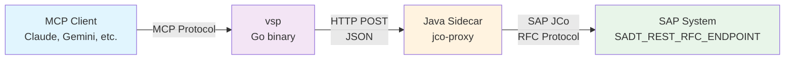

# RFC Connection Mode

## Why RFC?

SAP HTTP ports (50000 for HTTP, 44300 for HTTPS) are often blocked by corporate firewalls or network policies. RFC ports (33xx) are typically open because SAP GUI uses them for everyday work.

Eclipse ADT already has this capability -- the ABAP Development Tools in Eclipse can connect via RFC using SAP JCo libraries. vsp brings the same capability to AI agents and CLI workflows.

**When to use RFC mode:**
- SAP HTTP/HTTPS ports are blocked by firewalls
- You can reach the system via SAP GUI but not via browser
- Load-balanced connections via message server are preferred
- Your security team requires RFC-only access

**When HTTP mode is better:**
- HTTP ports are available (the simpler option)
- You don't have Java installed
- You want zero additional dependencies

## Architecture



The Java sidecar acts as a bridge between vsp (Go) and SAP JCo (Java). It:

1. Receives HTTP requests from vsp on localhost
2. Translates them into RFC calls via `SADT_REST_RFC_ENDPOINT`
3. Returns the SAP response as JSON back to vsp

From the MCP client's perspective, RFC mode is transparent -- all 122 tools work identically.

## Prerequisites

| Requirement | Details |
|-------------|---------|
| **Java 11+** | Same architecture as JCo native libraries (arm64 or x86_64) |
| **SAP JCo libraries** | From Eclipse ADT plugins folder or SAP Support Portal |
| **jco-proxy.jar** | Built from `sidecar/jco-proxy/` (Maven) |
| **SAP RFC user** | With ADT authorization (same as HTTP mode) |

## Quick Start

```bash
# 1. Run the setup wizard (finds JCo libs from Eclipse ADT)
vsp jco setup

# 2. Build the Java sidecar
cd sidecar/jco-proxy && mvn package && cd ../..

# 3. Configure .env for RFC mode
cat >> .env <<'EOF'
SAP_CONNECTION_MODE=rfc
SAP_ASHOST=sap-server.example.com
SAP_SYSNR=00
SAP_USER=DEVELOPER
SAP_PASSWORD=secret
SAP_CLIENT=001
SAP_JCO_LIBS_DIR=./jco-libs
SAP_JCO_PROXY_JAR=sidecar/jco-proxy/target/jco-proxy-1.0.0-shaded.jar
EOF

# 4. Start vsp (sidecar launches automatically)
vsp
```

## Configuration Reference

All settings follow the standard priority: **CLI flags > env vars > .env file > defaults**.

### RFC Connection Settings

| CLI Flag | Env Variable | Description | Required |
|----------|-------------|-------------|----------|
| `--connection-mode` | `SAP_CONNECTION_MODE` | `http` (default) or `rfc` | Yes (set to `rfc`) |
| `--ashost` | `SAP_ASHOST` | Application server hostname | Yes (direct) |
| `--sysnr` | `SAP_SYSNR` | System number (e.g., `00`) | Yes (direct) |
| `--mshost` | `SAP_MSHOST` | Message server host | Yes (load-balanced) |
| `--msserv` | `SAP_MSSERV` | Message server service/port | Yes (load-balanced) |
| `--r3name` | `SAP_R3NAME` | SAP system name | Yes (load-balanced) |
| `--group` | `SAP_GROUP` | Logon group | Yes (load-balanced) |

### JCo Sidecar Settings

| CLI Flag | Env Variable | Default | Description |
|----------|-------------|---------|-------------|
| `--jco-proxy-jar` | `SAP_JCO_PROXY_JAR` | (auto-detect) | Path to jco-proxy JAR |
| `--jco-libs-dir` | `SAP_JCO_LIBS_DIR` | `./jco-libs` | Path to JCo libraries directory |
| `--java-path` | `SAP_JAVA_PATH` | `java` | Path to Java binary |
| `--rfc-proxy-port` | `SAP_RFC_PROXY_PORT` | `0` (auto) | Fixed sidecar port |
| `--rfc-max-concurrent` | `SAP_RFC_MAX_CONCURRENT` | `5` | Max concurrent RFC calls |

### Connection Types

**Direct connection** (single application server):
```bash
vsp --connection-mode rfc --ashost sap-app.example.com --sysnr 00
```

**Load-balanced connection** (via message server):
```bash
vsp --connection-mode rfc \
    --mshost sap-msg.example.com --msserv 3600 \
    --r3name PRD --group PUBLIC
```

You cannot mix `--ashost` with `--mshost` -- choose one connection type.

## JCo Setup

The `vsp jco setup` wizard automates JCo library discovery and configuration:

```
$ vsp jco setup
=== JCo Setup Wizard ===

Step 1: Searching for JCo libraries...

Found JCo 3.1.12 (macosx/aarch64) in /Users/dev/.p2/pool/plugins
  JCo JAR:    com.sap.conn.jco_3.1.12.jar
  Native JAR: com.sap.conn.jco.macosx.aarch64_3.1.12.jar

Step 2: Copying to ./jco-libs/ for portability...
  Done.

Step 3: Extracting native library...
  Extracted: libsapjco3.dylib

Step 4: Validating Java installation...
  Java 21.0.1 (aarch64) at /usr/bin/java
  Architecture match: OK

Step 5: Checking jco-proxy.jar...
  Found: sidecar/jco-proxy/target/jco-proxy-1.0.0-shaded.jar

=== Setup Complete ===

Add to .env:
  SAP_CONNECTION_MODE=rfc
  SAP_JCO_LIBS_DIR=./jco-libs
  SAP_JCO_PROXY_JAR=sidecar/jco-proxy/target/jco-proxy-1.0.0-shaded.jar
```

The wizard searches these locations (in priority order):

| Priority | Location | Notes |
|----------|----------|-------|
| 1 | `./jco-libs/` | Local directory (highest priority) |
| 2 | `$SAP_JCO_LIBS_DIR` / `$JCO_LIBS_PATH` | Environment variables |
| 3 | `~/.p2/pool/plugins/` | Eclipse shared plugin pool |
| 4 | Platform-specific Eclipse dirs | `/Applications/Eclipse.app/...`, `C:\Program Files\Eclipse\...`, etc. |

Use `vsp jco status` for a quick non-interactive check:

```
$ vsp jco status
=== JCo Status ===

  JCo:      com.sap.conn.jco_3.1.12.jar v3.1.12 (macosx/aarch64)
  Native:   com.sap.conn.jco.macosx.aarch64_3.1.12.jar
  Lib:      libsapjco3.dylib
  Java:     21.0.1 (aarch64) at /usr/bin/java
  Proxy:    sidecar/jco-proxy/target/jco-proxy-1.0.0-shaded.jar

  Status: READY
```

## How It Works

### Request Flow

When a tool is called in RFC mode, the request flows through these layers:

```
1. MCP tool call (e.g., GetSource)
2. ADT Client calls Requester.Request(path, opts)
3. RfcTransport builds ProxyRequest JSON:
   {
     "method": "GET",
     "uri": "/sap/bc/adt/programs/programs/ZTEST?sap-client=001",
     "headers": {"Accept": "*/*", "X-sap-adt-sessiontype": "stateful"}
   }
4. POST to http://localhost:<port>/rfc-proxy
5. Java sidecar receives ProxyRequest
6. Calls SADT_REST_RFC_ENDPOINT via JCo (RFC)
7. SAP executes the ADT request internally
8. Response flows back as ProxyResponse JSON:
   {
     "statusCode": 200,
     "headers": {"Content-Type": "text/plain"},
     "body": "REPORT ztest.\n  WRITE 'Hello'."
   }
9. RfcTransport converts to adt.Response
10. Tool handler returns result to MCP client
```

### The Requester Interface

The key abstraction is the `Requester` interface in `pkg/adt/http.go`:

```go
type Requester interface {
    Request(ctx context.Context, path string, opts *RequestOptions) (*Response, error)
}
```

- **`Transport`** implements `Requester` for direct HTTP connections
- **`RfcTransport`** implements `Requester` by proxying through the Java sidecar

The ADT client doesn't know or care which transport is used -- it just calls `Request()`.

### Session Management

RfcTransport manages SAP sessions (sap-contextid) and CSRF tokens identically to the HTTP transport. The sidecar forwards cookies and headers transparently.

### Concurrency Control

RfcTransport uses a semaphore to limit concurrent RFC calls (default: 5). This prevents overwhelming the SAP system's RFC connection pool.

## Direct RFC Calls

The sidecar exposes a `/rfc-call` endpoint for calling SAP function modules directly:

```go
// Via SidecarManager
result, err := sidecar.CallRFC(ctx, "BAPI_USER_GET_DETAIL", map[string]interface{}{
    "USERNAME": "DEVELOPER",
})
```

This is exposed as the `CallRFC` MCP tool, which calls function modules without going through ADT REST APIs.

## Multi-System Configuration

Use `.vsp.json` to configure systems with different connection modes:

```json
{
  "default": "dev-http",
  "systems": {
    "dev-http": {
      "url": "http://dev.example.com:50000",
      "user": "DEVELOPER",
      "client": "001"
    },
    "dev-rfc": {
      "connection_mode": "rfc",
      "ashost": "dev.example.com",
      "sysnr": "00",
      "user": "DEVELOPER",
      "client": "001",
      "jco_proxy_jar": "/opt/vsp/jco-proxy.jar",
      "jco_libs_dir": "/opt/sap/jco"
    },
    "prod-lb": {
      "connection_mode": "rfc",
      "mshost": "sap-msg.prod.example.com",
      "msserv": "3600",
      "r3name": "PRD",
      "group": "PUBLIC",
      "user": "RFC_USER",
      "client": "100",
      "jco_proxy_jar": "/opt/vsp/jco-proxy.jar",
      "jco_libs_dir": "/opt/sap/jco",
      "read_only": true
    }
  }
}
```

Set passwords via environment variables:
```bash
export VSP_DEV_HTTP_PASSWORD=secret1
export VSP_DEV_RFC_PASSWORD=secret2
export VSP_PROD_LB_PASSWORD=secret3
```

Then use:
```bash
vsp -s dev-rfc search "ZCL_*"       # Direct RFC
vsp -s prod-lb source CLAS ZCL_FOO  # Load-balanced RFC
vsp -s dev-http export '$TMP'       # Standard HTTP
```

## Troubleshooting

### JCo libraries not found

```
JCo libraries not found in standard locations.
```

**Fix:** Run `vsp jco setup` and provide the path to your Eclipse plugins folder. Look for files matching `com.sap.conn.jco_*.jar`.

If you don't have Eclipse ADT installed, download JCo from the [SAP Support Portal](https://support.sap.com/en/product/connectors/jco.html) (requires S-user).

### Architecture mismatch

```
WARNING: Architecture mismatch! JCo is aarch64 but Java is x86_64
```

**Fix:** Install Java matching your JCo native library architecture. On macOS with Apple Silicon, ensure both are `aarch64`:
```bash
java -version  # Check Java architecture
file jco-libs/libsapjco3.dylib  # Check JCo native lib architecture
```

### Sidecar won't start

```
starting sidecar: exec: "java": executable file not found in $PATH
```

**Fix:** Install Java 11+ or specify the path:
```bash
vsp --java-path /usr/lib/jvm/java-17/bin/java
```

### Connection refused

```
sidecar request failed (is the sidecar running at http://localhost:54321?): connection refused
```

**Fix:** The sidecar may have crashed. Check stderr for Java stack traces. Common causes:
- JCo native library not extracted (run `vsp jco setup`)
- Port conflict (use `--rfc-proxy-port` to specify a different port)
- JCo classpath issues (ensure `sapjco3.jar` is in `--jco-libs-dir`)

### SAP connection errors

```
RFC call returned HTTP 500: ICM_HTTP_CONNECTION_FAILED
```

**Fix:** Check SAP connection parameters:
- Verify `--ashost` or `--mshost` is reachable: `ping sap-server.example.com`
- Verify system number: `telnet sap-server.example.com 3300` (for sysnr 00)
- Verify credentials: try connecting via SAP GUI first

### Timeout waiting for sidecar

```
timeout waiting for sidecar to start (30s)
```

**Fix:** The Java process is taking too long to initialize. Check:
- Java version (`java -version` -- must be 11+)
- JCo library integrity (re-run `vsp jco setup`)
- Available system memory (JCo requires ~256MB heap)

## Limitations

- **Requires Java runtime** -- not needed for standard HTTP mode. Only RFC mode needs Java.
- **WebSocket tools route through sidecar** -- debugger and AMDP tools use the sidecar's HTTP interface rather than direct WebSocket connections.
- **First request slightly slower** -- the sidecar auto-starts on first use and takes a few seconds to initialize JCo.
- **JCo licensing** -- SAP JCo is proprietary software. Ensure your organization has appropriate licensing.
- **Native library per platform** -- JCo requires a platform-specific native library (`libsapjco3.dylib` on macOS, `.so` on Linux, `.dll` on Windows). The architecture must match Java's architecture.
- **Debugger long-polling requires sufficient timeout** -- The `DebuggerListen` tool uses long-polling (up to 240 seconds) via `SADT_REST_RFC_ENDPOINT`. This works correctly over RFC (Eclipse ADT does the same), but the Go HTTP client connecting to the sidecar must not have a hard timeout shorter than the listener timeout. This was fixed by removing the hard `http.Client.Timeout` from `RfcTransport` and relying on context deadlines instead. See [Report 2026-03-04-001](../reports/2026-03-04-001-rfc-mode-debugger-limitations.md) for the full analysis and SAP debugger architecture reference.
